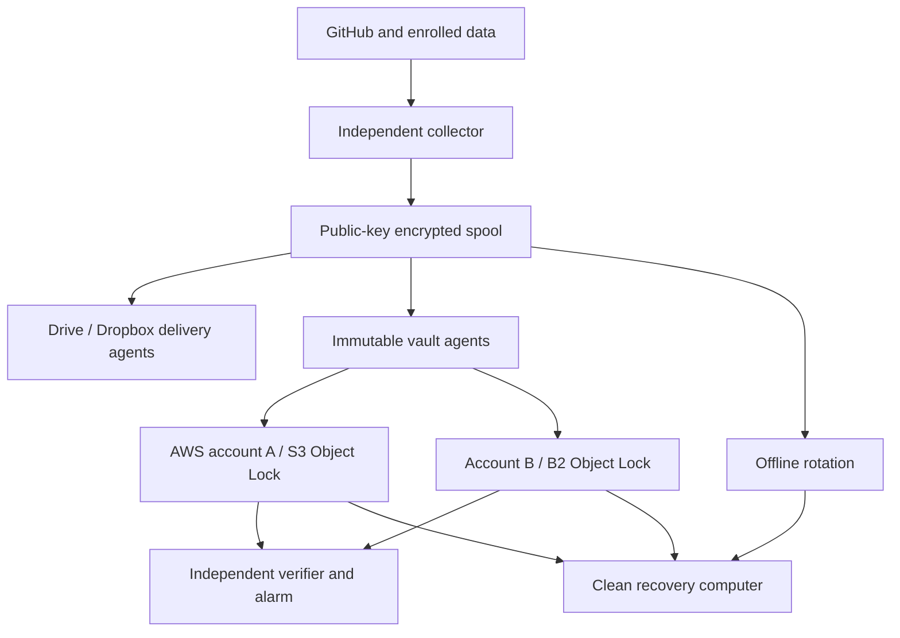

# RepoSafe technical architecture

Status: approved implementation direction from the owner's request; deployment
and production acceptance are separate gates. Basic snapshots and Drive/Dropbox
delivery exist. The later sections specify the hardened target, not a claim that
all components have been implemented. See DEVELOPMENT_PLAN.md and STATUS.md.

## 1. Objective and guarantees

Recover public/private source repositories and explicitly enrolled other data
after account takeover, deletion, ransomware, provider outage, credential loss,
collector compromise or silent corruption. Preserve confidentiality off the source
and recover without GitHub, the original collector, or its identity provider.

More providers alone do not require an attacker to compromise each independently.
A collector holding every provider token, a shared email recovery account, shared
SSO, or an online decryption key can collapse several failure domains into one.
The design therefore separates **source access, backup writing, retention control,
monitoring, recovery keys and account administration**.

No finite system promises recovery from every attack. An adversary controlling a
source and collector can poison future captures or stop backups. Surviving old
immutable/offline copies and an independent missed-backup alarm bound that risk.
Retention must exceed the time needed to discover and investigate a compromise.

Initial objectives, to be measured rather than asserted:

| Class | Target RPO | Target RTO | Acceptance evidence |
| --- | --- | --- | --- |
| Git repositories and enrolled files | 24 hours plus run time | One repo ≤1 hour; full account ≤24 hours subject to measured size/bandwidth | Timed clean-room recovery and ref/content comparison |
| Important databases | ≤1 hour after PITR/WAL adapter deployment | ≤4 hours subject to measured data size | Logical restore and application-level checks |
| Offline escape copy | ≤7 days with weekly rotation | ≤48 hours subject to media access | Retrieve disconnected media and restore without cloud accounts |
| Missing backups | Alert by 30 hours since last independently verified complete run | Operator acknowledgement target ≤4 hours | Disable runner/network and observe external alert |

## 2. Copy and failure-domain topology

The named agents represent separate security identities and ultimately separate
hosts/trust zones, not multiple processes on one machine pretending to be isolated.
The first independent runner may hold Drive and Dropbox tokens; it improves GitHub
independence but does not yet achieve full credential compartmentalization.

| Copy | Role | Enforcement and isolation |
| --- | --- | --- |
| GitHub | Working primary | Read-only backup credential; source changes never erase existing snapshots |
| Google Drive | Convenient offsite copy | Private dedicated folder/OAuth scope; mutable and not WORM |
| Dropbox | Provider-diverse convenient copy | Separate app/folder/account recovery; mutable and not WORM |
| S3 vault | Primary immutable archive | Separate account, versioning, default **COMPLIANCE** retention, public access blocked, explicit no-delete/no-retention-admin writer role |
| B2 vault | Independent provider immutable archive | Separate identity and billing recovery, Object Lock with compliance retention, restricted application key |
| Rotated offline media | Escape from online identity/control-plane failure | At least two encrypted devices, separate locations, one always disconnected; verify before rotation |

This exceeds a minimal 3-2-1-1-0 layout when deployed: multiple copies, different
storage media/providers, offsite copies, immutable/offline protection, and zero
unresolved verification errors. The label describes the operational target; it is
not a certification. Hardware/media and paid services require a budget decision.

## 3. Identity, key custody and least privilege

* Source token reads selected owners' repositories; no contents-write, repo-delete,
  Actions-write, organization-admin or secret-read privilege. Prefer a dedicated
  GitHub App with short-lived installation tokens once implemented. Verify each
  owner's all-repositories selection and organization/SSO grants separately.
* Collector contains only age **public recipients**. Generate native age X25519
  identities on a trusted recovery machine, with two separately secured offline
  copies. Multiple recipients are alternatives: any one can decrypt. They are
  not a two-person threshold scheme. Do not invent a new encryption format.
* Delivery agents see ciphertext, not source GitHub tokens or decryption keys.
  Each agent has only its own destination credential and encrypted input queue.
* Object-store writer cannot delete objects/versions, shorten retention, remove
  holds, bypass governance, disable versioning or alter bucket/account policy.
  Readers, retention operators and break-glass admins use different identities.
* Pin restore verification public keys/receipt digests outside the mutable backup
  location. Later signed receipts must be independently witnessed: a signing key
  on a compromised collector can authenticate malicious future captures.
* Account recovery uses independent email/SSO boundaries and hardware security keys
  with secured spares. A single Google login should not recover every vault.
* GitHub's automatic job token is scoped to its repository and is insufficient for
  all private repos. ChatGPT app OAuth is not exportable runtime authorization.

Age protects uploaded payload confidentiality/integrity. A malicious actor knowing
the public recipient can create a new valid encrypted archive, so age encryption
does not authenticate the collector or prove freshness. Content hashes need trusted
receipts, signatures/witnesses and last-success monitoring to address replacement
and rollback attacks. Size, timing, run IDs and aggregate counts remain observable.

## 4. Data acquisition and coverage

The source interface produces a private staging tree, inventory, coverage result
and consistency evidence. Exporters never execute project code. Mandatory exports
fail the run explicitly; completed exports can still be encrypted and delivered.

**Git:** authenticated fully paginated inventory by stable repository ID, including
public/private, archived and forked repos; owner allowlist; required/count guards;
previously observed IDs never silently disappear. Mirrors capture advertised refs,
tags and reachable history; `git fsck --full --strict` validates object structure.
Fetch all referenced LFS objects, verify their SHA-256 values, and record ref maps.
Submodule targets are enrolled separately. Empty repos are valid. A bare mirror
cannot recover history deleted before the first capture or refs GitHub hides.

**GitHub metadata:** progressively export issue/PR threads, reviews/comments,
discussions via GraphQL, wikis via separate Git mirrors, releases and asset bytes,
labels, milestones, rules/settings, collaborators where readable, and relevant
Actions artifacts before upstream expiry. Pagination, permissions, rate limiting,
binary redirect allowlists and per-endpoint failure coverage are explicit. Some
metadata can be retained as JSON but cannot be recreated with original IDs or
timestamps. Never advertise a Git mirror as a complete account export.

**Files:** explicitly configured absolute roots, private staging, declared
exclusions, byte/file budgets, no followed symlinks or special files, checks for
file changes while copied, encrypted content inventory. Snapshot a filesystem
first for strong cross-file consistency; a directory copy is not a database backup.

**Databases:** native `pg_dump`/restore for PostgreSQL (including Neon when enrolled),
PITR/WAL where justified; SQLite online backup API; application-aware adapters for
other engines. Never copy live database files as if that proved consistency.
Export declared environment/configuration metadata with secrets separately escrowed.

**Other services:** opt-in object storage, documents, deployments, DNS and password
manager recovery exports using service-specific read-only scopes. No broad account
scraping. Secrets unavailable from GitHub must come from independent secret custody.

## 5. Snapshot format and commit protocol

1. Acquire an OS-level run lock; record start/deadline and check available storage.
2. Inventory sources; compare expected and previously observed stable IDs.
3. Collect into private scratch on encrypted disk. Avoid Git checkouts/hooks,
   ambient Git helpers, token-bearing URLs and repo-controlled LFS endpoints.
4. Generate an encrypted inner manifest with source outcomes, exact coverage,
   consistency limitations and file SHA-256/size inventory. Archive regular data.
5. Encrypt using age recipients; erase the temporary tree through ordinary cleanup.
   SSD/cloud block erasure is not guaranteed; host encryption is required.
6. Store ciphertext under a new random run ID. Outer receipts reveal only opaque
   filenames, ciphertext hashes, bytes and aggregate status. No private repo names.
7. Each agent uploads ciphertext, reads it back and verifies bytes independently,
   then publishes the completion receipt **last**. Retain successful copies even
   when another agent fails. Never use destructive sync, overwrite or remote prune.
8. Immutable adapters additionally verify object version IDs, retention mode and
   retain-until date through provider APIs; reject a noncompliant vault. A delete
   marker is not deletion of a retained version: catalogs must retain version IDs.
9. Advance last-complete status only after source coverage and every required
   destination pass. Independently verify/witness the run before emitting health.

All statuses distinguish capture, upload, byte check, retention check and full
application restore. A downloaded hash match does not prove database usability.
Power loss or a failed upload leaves an incomplete run; it never promotes a partial
copy as a full success. Retry the same ciphertext with immutable semantics.

Full daily encrypted packages are deliberately simple and independently restorable,
but grow linearly with full dataset size. Later chunking/deduplication must preserve
the full dependency graph under retention, repair and version-aware restore. Do
not blindly run restic prune against WORM storage. A separately administered
append-only rest-server can be an efficient hot tier, not a substitute for WORM or
offline copies; client encryption credentials do not have public-key-only semantics.

## 6. Scheduling, monitoring and control-plane independence

The bootstrap GitHub workflow runs daily at 08:23 UTC and manually; PR jobs receive
no backup credentials and only read the RepoSafe checkout. Actions are pinned to
commit SHAs. A public-repo schedule can be disabled after 60 inactive days, delayed
or dropped, so it is not the final autonomous control plane.

Production runs on a dedicated independent host using a systemd timer with
`Persistent=true`, jitter, restricted service account, read-only software/config,
encrypted work volume, a deadline and exclusive lock. Install a reviewed release
locally; never `git pull main && execute` during a backup. GitHub compromise must
not automatically replace executable backup code. No source project code runs.

An independent monitor verifies both freshness and required-destination receipts.
Separate start/failure/success events detect jobs that never finish; success is
sent only after complete delivery. Alert on missing runs, coverage drops, volume
exhaustion, quota/rate errors, token expiry, retention drift and offline rotation
age. Heartbeat secrets alone prove neither source coverage nor restorability.
No messages are sent to people by development tooling unless separately requested;
operator-configured product alert integrations are part of deployment.

## 7. Retention, capacity and recovery

Proposed starting policy, subject to measured volume and explicit cost approval:
30 daily convenience snapshots, 90-day minimum S3 compliance retention, 365-day
secondary immutable retention, monthly/yearly long-term checkpoints, weekly offline
rotation. Compliance retention cannot be shortened on existing protected versions;
model costs and legal deletion requirements before applying it. Neither paid cloud
resources nor irreversible production retention are provisioned by these PRs.

Routine writers never prune. A separate maintenance principal simulates deletion,
checks required surviving generations and retention expiry, and requires a reviewed
change. Deleting source repos or removing token permissions must never authorize
backup deletion. Watch out for lifecycle expiry after lock expiration, account
closure/nonpayment, and external KMS key destruction defeating data availability.
Keep payload recovery independent of provider KMS by retaining offline age keys.

Capacity model: initial full size S, daily change D, full daily archive retention N
requires approximately S×N per destination before compression and version overhead.
Read-back verification incurs additional reads/egress. WORM bills persist through
the lock period even if credentials are revoked. Test realistic archives against
Drive/Dropbox file-size, quota and throughput constraints; shard/chunk in a later
PR before datasets exceed those limits. No unverified price assumptions are used.

The recovery kit contains reviewed RepoSafe source/wheel, Python/tool install
instructions, public verification roots/receipts, format schemas, age identities
under separate custody, owner inventory and a runbook. Copies exist outside GitHub.
Restores run in a new private directory with traversal/link/device/bomb defenses,
verify internal content hashes, then verify Git refs/LFS/application data. They do
not contact GitHub, run hooks or push anywhere. Check every repository at least
monthly on rotation; restore the full account quarterly and after format changes.

## 8. Security verification and release gates

Map each data flow to source → trusted collector → encrypted spool → TLS provider
→ clean recovery endpoint. TLS is transport security; age is client-side payload
encryption. Plaintext exists at trusted collection/recovery endpoints and in their
encrypted local storage. This applies the owner's end-to-end security requirement
without making an unsupported blanket compliance claim.

Required evidence: unit/API pagination tests; real Git/age/rclone recovery fixtures;
separate failure cases for provider outages, rate limits, auth expiry, wrong keys,
tampering, replay, missing sources, disk-full, interrupted jobs and unsafe archives;
real-provider permission/retention tests in explicitly funded test accounts;
independent alert drills; clean-machine recovery with GitHub unavailable; reviewed
supply-chain pins and dependency/tool updates. Update STATUS.md with exact evidence.

## 9. Primary references (reviewed 2026-10-17)

* [GitHub repository backups](https://docs.github.com/en/repositories/archiving-a-github-repository/backing-up-a-repository)
* [GitHub schedule semantics and inactivity](https://docs.github.com/en/actions/reference/workflows-and-actions/events-that-trigger-workflows#schedule)
* [GitHub authenticated repository inventory](https://docs.github.com/en/rest/repos/repos#list-repositories-for-the-authenticated-user)
* [age format and tools](https://github.com/FiloSottile/age)
* [rclone copy semantics](https://rclone.org/commands/rclone_copy/) and [downloaded-byte checking](https://rclone.org/commands/rclone_check/)
* [rclone Drive](https://rclone.org/drive/) and [Dropbox](https://rclone.org/dropbox/)
* [AWS Object Lock](https://docs.aws.amazon.com/AmazonS3/latest/userguide/object-lock.html)
* [Backblaze Object Lock](https://www.backblaze.com/docs/cloud-storage-object-lock) and [restricted application keys](https://www.backblaze.com/docs/cloud-storage-application-keys)
* [systemd timer semantics](https://www.freedesktop.org/software/systemd/man/latest/systemd.timer.html)
* [restic security considerations](https://restic.readthedocs.io/en/latest/100_references.html) and [rest-server](https://github.com/restic/rest-server)
